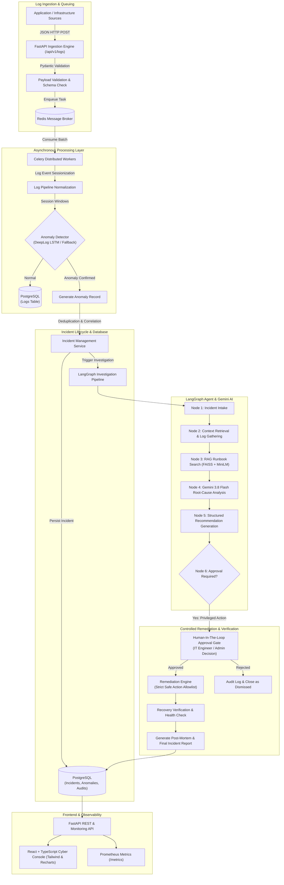

# SentinelOps — System Architecture Document

## 1. Executive Summary

**SentinelOps** is an enterprise-grade AI-powered IT Operations (AIOps) and Incident Management platform. It automates the end-to-end lifecycle of infrastructure and application incidents: from asynchronous log ingestion, machine learning anomaly detection (via an LSTM-based DeepLog engine or robust rule-based fallbacks), and PostgreSQL incident tracking, to RAG-grounded investigation with Google's Gemini 3.8 Flash model, LangGraph agentic orchestration, human-in-the-loop remediation controls, and automated recovery verification.

---

## 2. End-to-End System Architecture



---

## 3. Detailed Component Breakdown

### 3.1. API & Ingestion Engine (FastAPI)
- **Role**: Non-blocking ingestion gateway, authentication, resource CRUD, query service.
- **Protocol**: HTTP/JSON REST API with OpenAPI v3 auto-documentation.
- **Authentication**: JWT Bearer tokens with secure password hashing (`bcrypt`) and Role-Based Access Control (RBAC) supporting `Admin`, `IT Engineer`, and `Viewer` roles.
- **Asynchrony**: Log ingestion returns `202 Accepted` immediately upon pushing to Redis, guaranteeing sub-millisecond response latency even under high throughput.

### 3.2. Queuing & Worker Layer (Redis + Celery)
- **Broker & Backend**: Redis 7.x.
- **Tasks**:
  - `process_log_batch`: Validates, normalizes, and indexes log streams.
  - `detect_anomalies`: Runs sliding window sequences against the anomaly detector.
  - `create_incident_from_anomaly`: Applies deduplication windows to prevent alert storms.
  - `execute_investigation`: Runs LangGraph workflow asynchronously.
  - `execute_remediation`: Executes human-approved mitigation actions.
- **Resilience**: Bounded exponential backoff retries, dead-letter recording, and fallback execution when workers are degraded.

### 3.3. Anomaly Detection Engine (DeepLog LSTM & Fallbacks)
- **DeepLog Integration**:
  - Model: 2-layer LSTM (`hidden_size=64`, `embedding_dim=32`, `window_size=10`).
  - Parsing: Drain3 log template miner with regular expression masking for IP addresses, numbers, and hex IDs.
  - Inference: Top-$g$ prediction ($g=5$); flags anomalies when observed event template diverges from learned patterns.
  - Checkpoint: Loads trained `deeplog_lstm.pth` weights and `vocab.pkl` mappings from workspace.
- **Rule-Based Fallback**:
  - Heuristic pattern-matcher inspecting severity levels, repeated stack traces, error burst density, and socket exceptions when model files are not loaded.

### 3.4. RAG Knowledge Base (SentenceTransformers + FAISS)
- **Embeddings**: `all-MiniLM-L6-v2` dense vector model (384-dimensional).
- **Index**: FAISS `IndexFlatIP` (Cosine similarity via normalized inner product).
- **Runbooks**: Standard Operating Procedures (SOPs) for Database Outages, CPU Spikes, Memory Leaks, Redis Failures, API Latency, Worker Crashes, and Network Partitions.
- **Retrieval Threshold**: Cosine similarity cutoff $\ge 0.35$ with bounded top-$k$ matches to prevent irrelevant hallucinated context.

### 3.5. LLM Investigation Service (Google Gemini 3.8 Flash)
- **SDK**: Official `google-genai` Python client.
- **Model**: `gemini-3.8-flash` (configurable via `GEMINI_MODEL`).
- **Prompt Architecture**: System instructions enforcing zero hallucination, strict structured JSON schema, threat isolation against prompt injection in raw logs, and severity/risk calculation.
- **Safety**: Sanitizes output, strips API keys, validates JSON via Pydantic models.

### 3.6. Agentic Orchestration (LangGraph)
- **Graph State**: Typed `InvestigationState` carrying incident metadata, logs, retrieved runbooks, LLM analysis, remediation proposal, approval status, and execution telemetry.
- **Flow**:
  1. `intake` -> 2. `gather_logs` -> 3. `rag_retrieval` -> 4. `root_cause_analysis` -> 5. `propose_remediation` -> 6. `approval_gate` -> 7. `execute_remediation` -> 8. `verify_recovery` -> 9. `finalize_report`.
- **Checkpointing**: State persisted between node transitions, supporting asynchronous human approval resumption.

### 3.7. Remediation Engine
- **Strict Allowlist**:
  1. `restart_service`: Restarts simulated containerized target service.
  2. `clear_cache`: Purges specified Redis cache keys.
  3. `scale_workers`: Adjusts worker pool concurrency.
  4. `run_health_check`: Executes synthetic probes against HTTP/TCP endpoints.
- **Safety Contract**: Never executes arbitrary shell commands. Only predetermined parameterized routines are executable.

---

## 4. Database Architecture & ER Diagram

```mermaid
erDiagram
    USERS ||--o{ AUDIT_LOGS : performs
    USERS ||--o{ INCIDENTS : assigned_to
    USERS ||--o{ REMEDIATION_REQUESTS : approved_by

    INCIDENTS ||--o{ LOGS : correlates
    INCIDENTS ||--o{ ANOMALIES : triggers
    INCIDENTS ||--one INVESTIGATION_REPORTS : produces
    INCIDENTS ||--o{ REMEDIATION_REQUESTS : initiates

    REMEDIATION_REQUESTS ||--one REMEDIATION_EXECUTIONS : executes

    DOCUMENTS ||--o{ DOCUMENT_CHUNKS : contains

    USERS {
        uuid id PK
        string email UK
        string hashed_password
        string full_name
        string role
        boolean is_active
        timestamp created_at
    }

    LOGS {
        uuid id PK
        timestamp timestamp
        string application
        string service
        string level
        text message
        string hostname
        json metadata
        string status
        uuid incident_id FK
    }

    ANOMALIES {
        uuid id PK
        timestamp timestamp
        string service
        float anomaly_score
        string actual_event
        string predicted_events
        string detection_method
        text supporting_evidence
        uuid incident_id FK
    }

    INCIDENTS {
        uuid id PK
        string title
        text description
        string severity
        string status
        string source
        uuid assigned_engineer_id FK
        string deduplication_key UK
        timestamp created_at
        timestamp updated_at
    }

    DOCUMENTS {
        uuid id PK
        string title
        string category
        text content
        string file_path
        timestamp created_at
    }

    INVESTIGATION_REPORTS {
        uuid id PK
        uuid incident_id FK UK
        text executive_summary
        text root_cause
        json supporting_evidence
        json recommended_actions
        string severity_assessment
        string risk_assessment
        float confidence_score
        text post_mortem
        timestamp created_at
    }

    REMEDIATION_REQUESTS {
        uuid id PK
        uuid incident_id FK
        string action_type
        json parameters
        string status
        string rationale
        uuid requested_by FK
        uuid approved_by FK
        timestamp created_at
    }

    REMEDIATION_EXECUTIONS {
        uuid id PK
        uuid request_id FK UK
        string status
        json output
        boolean recovery_verified
        timestamp executed_at
    }

    AUDIT_LOGS {
        uuid id PK
        uuid user_id FK
        string action
        string target_resource
        json details
        string ip_address
        timestamp timestamp
    }
```

---

## 5. Security & Isolation Model

1. **Authentication & Authorization**:
   - RFC 7519 JSON Web Tokens (JWT) signed with HMAC-SHA256.
   - Granular RBAC guards on sensitive routes (e.g. only `Admin` and `IT Engineer` can trigger or approve remediation).
2. **Defensive AI Engineering**:
   - Log sanitization removes dangerous prompt delimiters (`{{`, `}}`, `<system>`).
   - Grounded context from runbooks is marked read-only within LLM prompts, preventing indirect prompt injections from logs altering execution flow.
3. **Remediation Sandbox**:
   - Isolated simulation runner ensures zero modifications can touch host processes or OS shells.
