# SentinelOps — AI-Powered Enterprise IT Operations & Incident Management Platform

[](https://github.com/sentinelops/sentinelops/actions)
[](https://www.python.org/)
[](https://fastapi.tiangolo.com/)
[](https://react.dev/)
[](https://pytorch.org/)
[](https://langchain-ai.github.io/langgraph/)
[](LICENSE)

SentinelOps is a production-grade, autonomous IT operations platform that models how enterprise Site Reliability Engineering (SRE) and Security Operations (SecOps) teams detect infrastructure anomalies, conduct root-cause investigations, retrieve operational runbooks, and perform controlled, human-verified remediation.

Engineered specifically to solve **alert fatigue** and compress **Mean Time to Resolution (MTTR)** from hours to seconds, SentinelOps couples deep sequence machine learning (**DeepLog LSTM**) with agentic cognitive reasoning (**LangGraph + Google Gemini 3.8 Flash**), vector-based retrieval (**FAISS + SentenceTransformers**), and a cryptographic **Two-Man Rule** human approval gate.

---

## 1. System Architecture

```mermaid
flowchart TD
    subgraph Ingestion ["1. High-Throughput Telemetry Ingestion"]
        Logs["Microservices & Host Logs"] -->|REST POST /batch| FastAPIIngest["FastAPI Ingestion Endpoint"]
        FastAPIIngest -->|Pydantic V2 Validation| Correlation["Correlation ID & Audit Logger"]
    end

    subgraph AsyncQueue ["2. Asynchronous Queue Layer"]
        Correlation -->|Task Dispatch| RedisBroker[("Redis Broker & Result Store")]
        RedisBroker --> CeleryWorkers["Celery Worker Pool"]
    end

    subgraph AnomalyEngine ["3. DeepLog Machine Learning Engine"]
        CeleryWorkers --> Drain3["Drain3 Template Parser"]
        Drain3 --> SequenceWindow["Sliding Window (W=10)"]
        SequenceWindow --> PyTorchLSTM["PyTorch 2-Layer LSTM Model"]
        PyTorchLSTM -->|Top-g Candidate Check| BreachCheck{"Anomaly Score > 0.85?"}
    end

    subgraph IncidentDB ["4. Incident Persistence & Deduplication"]
        BreachCheck -->|Yes| CorrelateIncident["Incident Correlator"]
        CorrelateIncident --> Postgres[("PostgreSQL 16 DB")]
    end

    subgraph AgenticAI ["5. LangGraph & Gemini 3.8 Flash Investigation"]
        Postgres -->|Trigger Investigation| StateMachine["LangGraph 9-Node StateGraph"]
        StateMachine -->|Dense Cosine Search| FAISSStore[("FAISS Vector Index (all-MiniLM-L6-v2)")]
        FAISSStore -->|Curated Runbooks| StateMachine
        StateMachine -->|Delimited Context| GeminiLLM["Google Gemini 3.8 Flash LLM"]
        GeminiLLM -->|Pydantic Schema Output| RootCauseReport["Investigation Report & Remediation Proposal"]
    end

    subgraph RemediationGate ["6. Zero-Trust Remediation & Recovery"]
        RootCauseReport --> Gate{"Human Approval Gate"}
        Gate -->|Pending| WebConsole["React Operations Console"]
        WebConsole -->|POST /approve with JWT| AuthorizedAction["Approved Action"]
        AuthorizedAction --> Sandbox["Sandboxed Allowlisted Execution"]
        Sandbox --> HealthProbe["Automated Recovery Verification Probe"]
        HealthProbe -->|Healthy: True| ResolvedStatus["Auto-Resolve Incident & Commit Audit Trail"]
    end
```



---

## 2. Key Capabilities & Technical Highlights

| Component | Technical Implementation | Enterprise Value |
| :--- | :--- | :--- |
| **Telemetry Ingestion** | FastAPI, uvloop, Pydantic V2 schemas, `X-Correlation-ID` tracing | Non-blocking ingestion handling bursts of logs without starving API threads. |
| **Asynchronous Engine** | Redis broker, Celery worker pool, bounded retries, exponential backoff | Heavy ML inference and LLM calls run decoupled from client HTTP cycles. |
| **Deep Sequence ML** | PyTorch 2-layer LSTM (`hidden=64`, `vocab=31`), Drain3 parser, sliding window ($W=10$, $g=5$) | Detects structural execution sequence anomalies before threshold alerts fire. |
| **RAG Knowledge Base** | SentenceTransformers (`all-MiniLM-L6-v2`), FAISS `IndexFlatIP`, chunking with overlap | Surfaces verified troubleshooting runbooks with sub-millisecond semantic search. |
| **Agentic Investigation** | LangGraph 9-node StateGraph, cyclical routing, official `google-genai` SDK (`gemini-3.8-flash`) | Orchestrates structured investigations, isolates untrusted logs, prevents hallucinations. |
| **Human-in-the-Loop** | Role-Based Access Control (`Admin`, `IT Engineer`, `Viewer`), cryptographic approval gate | Enforces Two-Man Rule on privileged operations; eliminates rogue remediation. |
| **Safe Remediation** | Idempotent allowlist (`restart_service`, `clear_cache`, `scale_workers`, `run_health_check`) | Strictly prevents arbitrary shell code execution (RCE) and verifies recovery. |
| **Operations Dashboard** | React 18, TypeScript, Tailwind CSS, Recharts, Lucide Icons | Dark cybersecurity NOC console with live incident metrics and triage drilldowns. |

---

## 3. Technology Stack

- **Backend**: Python 3.11+, FastAPI, SQLAlchemy 2.0, PostgreSQL 16, Alembic, Redis 7, Celery 5.3, Pytest.
- **Machine Learning & AI**: PyTorch, Drain3, SentenceTransformers, FAISS, LangGraph, Google Gemini 3.8 Flash (`google-genai`).
- **Frontend**: React 18, TypeScript, Vite, Tailwind CSS, Recharts, Axios, Lucide Icons.
- **DevOps & Infrastructure**: Docker, Docker Compose, Nginx, GitHub Actions CI/CD, Prometheus OpenMetrics.

---

## 4. Repository Layout

```
sentinelops/
├── backend/
│   ├── app/
│   │   ├── agents/          # LangGraph 9-node investigation workflow & state
│   │   ├── ai/              # Google Gemini 3.8 Flash provider, schemas, prompt guards
│   │   ├── api/             # FastAPI routes (auth, logs, incidents, knowledge, remediations, tasks)
│   │   ├── core/            # Config, bcrypt/JWT security, structured JSON logging
│   │   ├── database/        # SQLAlchemy engine, session factory, connection pooling
│   │   ├── detection/       # DeepLog LSTM architecture, weights, Drain3 parser, rule fallback
│   │   ├── models/          # 10 SQLAlchemy ORM entities (Logs, Incidents, Anomalies, etc.)
│   │   ├── rag/             # SentenceTransformers embedding engine & FAISS vector store
│   │   ├── remediation/     # Allowlisted execution engine & automated health verifier
│   │   ├── schemas/         # Pydantic V2 data contracts
│   │   ├── services/        # Domain business logic (users, logs, incidents, audit)
│   │   ├── workers/         # Celery instance, background tasks, synchronous fallback pipeline
│   │   └── main.py          # FastAPI application entrypoint & middleware
│   ├── tests/               # 15 automated pytest suites
│   ├── requirements.txt     # Python pinned dependencies
│   └── Dockerfile           # Multi-stage production backend image
├── frontend/
│   ├── src/
│   │   ├── components/      # Navbar, Sidebar, Recharts metric widgets
│   │   ├── context/         # AuthContext (JWT state management)
│   │   ├── pages/           # Dashboard, Incidents, IncidentDetails, Logs, RAG, Remediations
│   │   └── services/        # Axios API client
│   ├── package.json
│   ├── vite.config.ts
│   └── Dockerfile           # Multi-stage production Nginx Alpine image
├── knowledge_base/
│   └── runbooks/            # 8 enterprise troubleshooting runbooks (DB, Memory, Redis, etc.)
├── scripts/
│   ├── demo_scenario.py     # End-to-end interactive demo script
│   └── generate_synthetic_logs.py # Synthetic telemetry failure injector
├── docker-compose.yml       # 5-tier microservice composition
├── ARCHITECTURE.md          # Complete architecture diagrams & 10-table ER model
├── API_DOCUMENTATION.md     # Full REST API specification
├── SECURITY.md              # Threat model & Zero-Trust security posture
├── INTERVIEW_READINESS.md   # Palo Alto Networks interview guide (40 Q&As, pitches, design)
└── README.md
```

---

## 5. Quickstart Guide

### Option A: Run with Docker Compose (Recommended)

To launch the full distributed stack (PostgreSQL, Redis, FastAPI, Celery Worker, and React Nginx Frontend):

1. **Clone the repository**:
   ```bash
   git clone https://github.com/sentinelops/sentinelops.git
   cd sentinelops
   ```

2. **Configure your environment**:
   ```bash
   cp .env.example .env
   # Edit .env and paste your Google Gemini API key:
   # GEMINI_API_KEY=your_actual_key_here
   ```

3. **Build and start services**:
   ```bash
   docker-compose up --build -d
   ```

4. **Access the platform**:
   - **Frontend Operations Dashboard**: [http://localhost:3000](http://localhost:3000)
   - **Backend API & Swagger UI**: [http://localhost:8000/docs](http://localhost:8000/docs)
   - **Prometheus Metrics Endpoint**: [http://localhost:8000/metrics](http://localhost:8000/metrics)
   - **Default Credentials**:
     - Administrator: `admin@sentinelops.io` / `admin`
     - IT Engineer: `engineer@sentinelops.io` / `engineer`

---

### Option B: Local Development Setup

#### 1. Backend Setup
```bash
# Create and activate Python virtual environment
python -m venv venv
# Windows: venv\Scripts\activate | Unix: source venv/bin/activate

# Install dependencies
pip install -r backend/requirements.txt

# Run database migrations and seed default runbooks
python -c "from backend.app.database.session import Base, engine; Base.metadata.create_all(bind=engine)"
python -c "from backend.app.database.session import SessionLocal; from backend.app.services.user_service import UserService; from backend.app.rag.service import rag_service; db = SessionLocal(); UserService.seed_default_users(db); rag_service.seed_default_runbooks(db)"

# Start FastAPI server
uvicorn backend.app.main:app --host 0.0.0.0 --port 8000 --reload
```

#### 2. Frontend Setup
```bash
cd frontend
npm install
npm run dev
# Vite server starts at http://localhost:5173
```

---

## 6. End-to-End Interactive Demonstration

SentinelOps includes a standalone demonstration script that exercises the full autonomous pipeline—ingesting failure telemetry, executing DeepLog sequence detection, correlating an incident, retrieving FAISS runbooks, performing Gemini root-cause analysis via LangGraph, evaluating the human approval gate, executing the allowlisted mitigation, and verifying recovery:

```bash
python scripts/demo_scenario.py
```

### Demonstration Execution Log Output:
```text
================================================================================
 >>> SENTINELOPS — END-TO-END DEMONSTRATION WORKFLOW
================================================================================
[Stage 1] Initializing Database & Seeding Knowledge Base...
✓ Default Admin & IT Engineer seeded.
✓ 8 Standard Runbooks indexed in FAISS vector store.

[Stage 2] Telemetry Ingestion & Anomalous Logs...
✓ Ingested 4 logs into staging buffer.

[Stage 3] Running Async DeepLog Anomaly Detection...
✓ Pipeline Result: {'status': 'success', 'processed': 4, 'anomalies': 4}
✓ Incident Auto-Generated:
  - Incident ID: 14b8d70e-8134-4a4b-a736-eeb86a412760
  - Title: Anomaly Detected in billing-service: FATAL
  - Severity: CRITICAL
  - Status: OPEN

[Stage 4] RAG Runbook Retrieval (FAISS + MiniLM)...
[1] Runbook: 'Database Connection Failures' | Similarity: 0.5962
[2] Runbook: 'Database Connection Failures' | Similarity: 0.5172

[Stage 5] LangGraph Agentic Workflow & Gemini Investigation...
✓ LangGraph State History:
  * 1. Incident Intake completed
  * 2. RAG Context Retrieval completed
  * 3. Log Analysis completed (3 logs correlated)
  * 4. Root Cause Analysis generated with Gemini 3.8 Flash
  * 5. Generated Remediation Proposal (8d5da251-1e62-4891-8194-41abe78919bb)
  * 6. Human Approval Gate evaluated: Status is PENDING
[AI Investigation Report]:
  - Root Cause: Database connection pool saturated by spike in unclosed client sessions.
  - Approval Status: PENDING

[Stage 6] Human Approval Gate & Safe Execution...
Engineer (Principal Security Admin) authorizing remediation request...
✓ Request Cryptographically Approved.
Executing allowlisted mitigation routine in sandbox...
✓ Remediation Execution Output: Successfully performed simulated rolling restart of billing-service pod replicas.
✓ Automated Recovery Verification Probe: Healthy = True

[Stage 7] Final Incident Post-Mortem & Resolution...
Incident Current Status: RESOLVED
Verified Recovered: True

✓ DEMONSTRATION WORKFLOW SUCCESSFULLY CONCLUDED!
```

---

## 7. REST API Walkthrough with `curl`

### 1. Ingest Telemetry Logs
```bash
curl -X POST http://localhost:8000/api/v1/logs \
  -H "Content-Type: application/json" \
  -d '{
    "application": "payment-gateway",
    "service": "billing-service",
    "level": "ERROR",
    "message": "Database connection pool timeout while acquiring connection",
    "hostname": "srv-prod-01",
    "metadata": {"pool_size": 20, "active_conns": 20}
  }'
```

### 2. Authenticate & Obtain JWT Token
```bash
curl -X POST http://localhost:8000/api/v1/auth/login \
  -H "Content-Type: application/json" \
  -d '{
    "email": "admin@sentinelops.io",
    "password": "admin"
  }'
```

### 3. Query Active Incidents
```bash
curl -X GET http://localhost:8000/api/v1/incidents?status=OPEN \
  -H "Authorization: Bearer <JWT_TOKEN>"
```

### 4. Semantic Vector Search on Runbooks
```bash
curl -X POST http://localhost:8000/api/v1/knowledge/search \
  -H "Authorization: Bearer <JWT_TOKEN>" \
  -H "Content-Type: application/json" \
  -d '{
    "query": "Database connection pool timeout exhausted",
    "top_k": 2
  }'
```

### 5. Approve Remediation Action (Human-in-the-Loop)
```bash
curl -X POST http://localhost:8000/api/v1/remediations/{request_id}/approve \
  -H "Authorization: Bearer <JWT_TOKEN>"
```

---

## 8. Automated Test Suite

SentinelOps includes an end-to-end automated testing suite with 100% test pass rate across unit, integration, and agentic workflows:

```bash
# Run pytest with test isolation
python -m pytest backend/tests/ -v
```

### Test Coverage Breakdown:
- `test_auth_and_incidents.py`: User registration, bcrypt authentication, JWT token expiry, RBAC enforcement, incident deduplication.
- `test_anomaly_detection.py`: PyTorch DeepLog LSTM sequence inference, top-g candidate evaluation, Drain3 template extraction, rule-based fallback.
- `test_rag.py`: Text chunking with overlap, `SentenceTransformer` dense embedding generation, FAISS inner product vector similarity retrieval.
- `test_ai_investigation.py`: Gemini prompt construction, Pydantic schema validation, LLM response formatting, mock fallback resilience.
- `test_langgraph_workflow.py`: 9-node cyclical StateGraph execution, conditional approval gating, state transition history.
- `test_remediation.py`: Strict allowlist parameter enforcement, human approval transition, sandbox execution, automated recovery verification.

---

## 9. Comprehensive Documentation Sitemap

- [System Architecture & 10-Table ER Model](ARCHITECTURE.md)
- [REST API Specification](API_DOCUMENTATION.md)
- [Zero-Trust Security & Threat Model](SECURITY.md)
- [Palo Alto Networks Interview Readiness & 40 Q&A Guide](INTERVIEW_READINESS.md)
- [Implementation Plan Tracking](IMPLEMENTATION_PLAN.md)
- [Development Status Matrix](DEVELOPMENT_STATUS.md)

---

## 10. License

This project is licensed under the MIT License — see the [LICENSE](LICENSE) file for details. Built for enterprise Site Reliability Engineering and AI operations.

